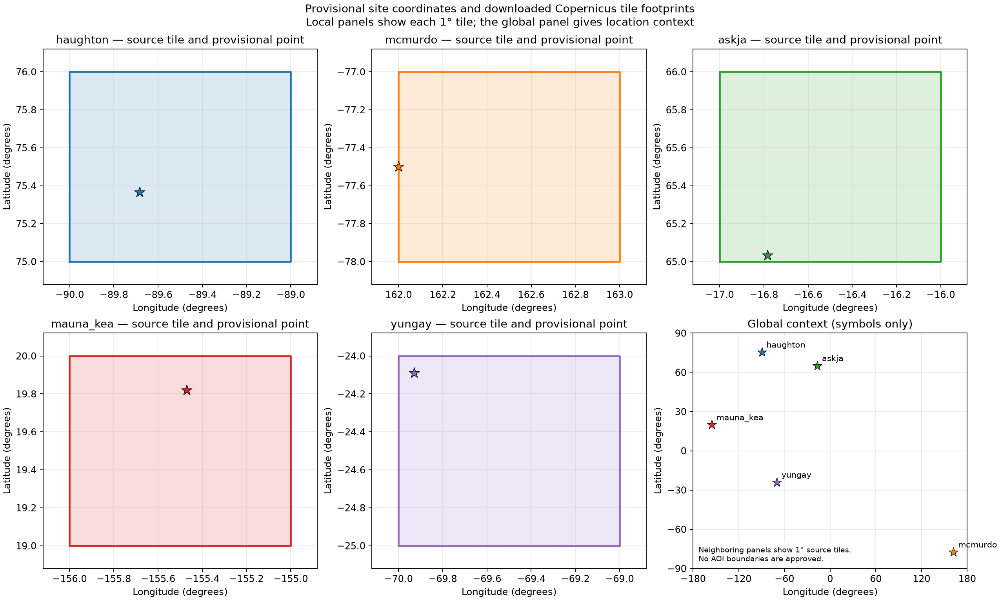
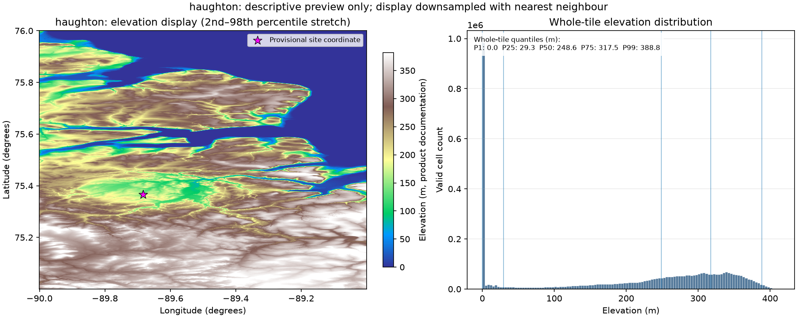
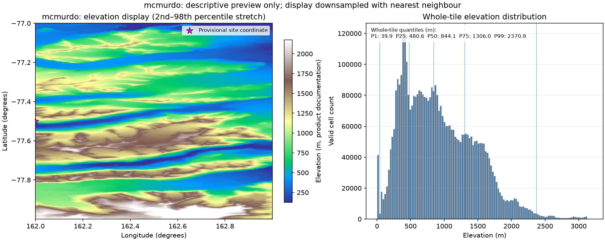
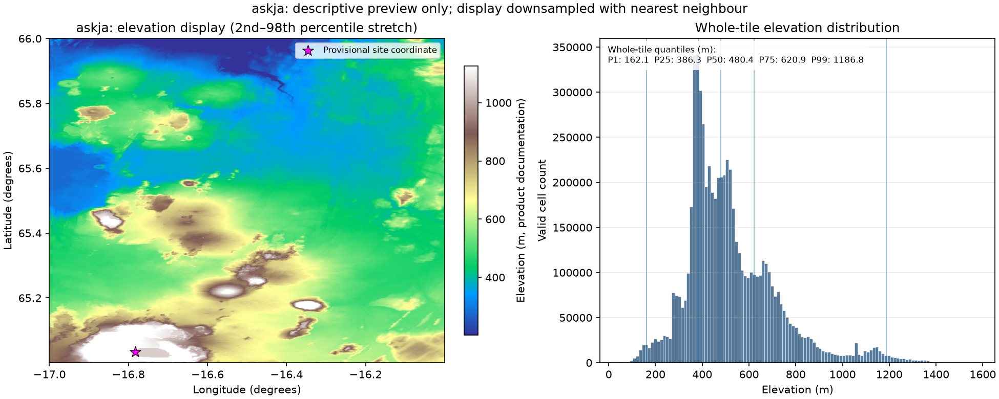
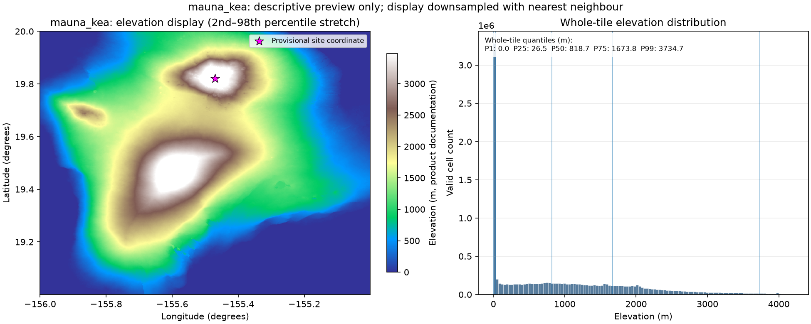
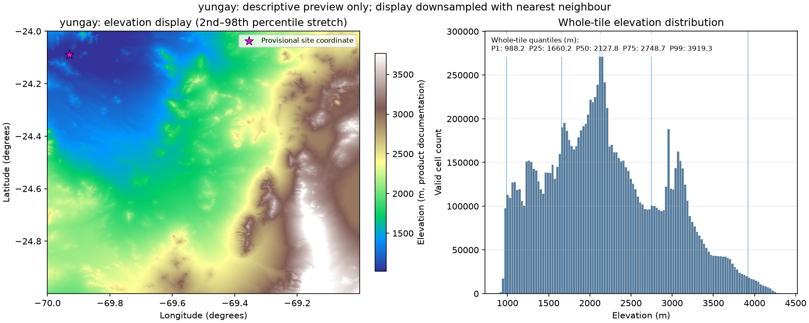

# Earth DEM candidate screening

**Status:** Provisional source-data screening only. None of the site coordinates, proposed candidate areas, or AOIs is approved.
**Method:** Read-only verification and descriptive visualization of local Copernicus GLO-30 DSM tiles. No source raster was changed, reprojected, resampled as analysis data, or fingerprinted.

## Spatial overview



The map uses longitude/latitude axes and is for location/coverage context only. Tile rectangles show downloaded source footprints, not candidate AOIs. Stars mark coordinates copied from the source manifest.

## Local integrity and grid inventory

The screening utility recomputes SHA-256 for each local TIFF, checks the manifest source ID and CRS, confirms the provisional coordinate lies inside the raster, and compares the local hash and file size to the QA JSON. Full values and any discrepancies are in the script output/API; the table summarizes the native grids.

| Site | Native dimensions | Pixel spacing (degrees; x × y) | Approx. ground spacing at provisional coordinate (x × y) | Integrity |
|---|---:|---:|---:|---|
| haughton | 1200 × 3600 | 0.00083333 × 0.00027778° | ~24 × 31 m at coordinate | verified |
| mcmurdo | 1200 × 3600 | 0.00083333 × 0.00027778° | ~20 × 31 m at coordinate | verified |
| askja | 1800 × 3600 | 0.00055556 × 0.00027778° | ~26 × 31 m at coordinate | verified |
| mauna_kea | 3600 × 3600 | 0.00027778 × 0.00027778° | ~29 × 31 m at coordinate | verified |
| yungay | 3600 × 3600 | 0.00027778 × 0.00027778° | ~28 × 31 m at coordinate | verified |

Every candidate has one local TIFF, a matching manifest checksum and source ID, a matching QA JSON checksum/file size, EPSG:4326, one float32 band, the provisional coordinate inside the tile, and 100% valid pixels under the existing raster mask. The product rasters declare no NoData value; full-mask coverage does not mean all cells are land or equally useful. The QA Markdown/JSON and source files remain the records of dimensions, bounds, and checksums.

The native angular grid is latitude-dependent: the observed x spacing is 3 arc-seconds at Haughton and McMurdo, 2 arc-seconds at Askja, and 1 arc-second at Mauna Kea and Yungay; y spacing is 1 arc-second. Approximate geodesic spacing at the marked coordinate is reported for context only. This is not a selected analysis resolution or a claim about effective terrain resolution.

## Elevation previews and distributions

### haughton



### mcmurdo



### askja



### mauna_kea



### yungay



Each histogram and quantile describes the entire 1° source tile, not the marked site or a proposed smaller candidate area. This matters especially where tiles include ocean, ice, or broad elevation gradients. Map colors use a tile-specific 2nd–98th percentile display stretch; the image is downsampled with nearest-neighbour sampling for display only. Neither visualization changes the source raster or defines a threshold.

## Data issues and limitations

- These are Copernicus GLO-30 **digital surface model** tiles. Buildings and vegetation can contribute where present; the product is not a uniform bare-earth terrain source.
- The manifest/QA verification passed, but all-mask-valid coverage is a storage/mask observation. It does not validate vertical accuracy, spatial completeness, source artifacts, or physical suitability. Some valid cells are near zero or below zero; in coastal/island tiles, water and land may both affect whole-tile statistics.
- Copernicus describes editing/filling, height-error, and water-body quality layers, but companion layers were not downloaded. The current QA reports do not inspect those absent layers.
- Product posting and effective terrain resolution are different concepts. Native grid dimensions vary with latitude, and the manifest does not identify the exact package release from the filename. Do not infer effective resolution from `GLO-30`, angular pixel spacing, or the display thumbnails.
- The downloaded files are full source tiles. No clipping, reprojection, or analysis resampling was performed. Their CRS is geographic; any later physical-area comparison needs a team-approved preparation method and scale.
- A single global product makes acquisition/provenance consistent across candidates, but it does not make local data quality or source conditions equivalent. This report compares availability and metadata only, not similarity to lunar terrain.

## Provisional smaller-area concepts (not AOIs)

| Site | Candidate concept to delineate with the team | Evidence needed before drawing/approving a boundary |
|---|---|---|
| Haughton | A land-only subarea centered on a verified impact-crater rim/floor sector. | Confirm crater boundary and whether a regional ArcticDEM surface/mask set is preferable; current point is a landmark, not an AOI center. |
| McMurdo | One named Dry Valley basin or valley segment, selected with the science team. | The provisional coordinate lies near the western edge of this tile; confirm the intended valley and retrieve any adjacent tile needed to cover it. Compare REMA and its quality companions. |
| Askja | The caldera or a named volcanic landform within the downloaded tile. | Confirm the intended landform boundary and inspect Copernicus quality layers; the current coordinate is a volcano landmark. |
| Mauna Kea | A summit-complex or flank sector, with the land/ocean boundary explicitly excluded if appropriate. | Confirm which geomorphic unit is the target and check exact 3DEP availability/vertical metadata against the same area. |
| Yungay | A bounded field-site terrain patch around the verified Yungay field location. | Confirm exact site coordinates and boundary from the project/source record; inspect the local mask and compare an independent regional source if needed. |

These descriptions intentionally contain no invented dimensions or coordinates. They are scoping prompts only; create no polygon or clipped raster until the team approves exact boundaries.

## Recommended next investigations

1. **Askja and Mauna Kea:** inspect a precisely agreed landform subarea and retrieve product quality assets. The current local rasters have 2- and 1-arc-second longitudinal grids respectively; this is metadata context, not a ranking of science quality.
2. **Haughton and McMurdo:** investigate regional alternatives in parallel because ArcticDEM and REMA offer distinct polar coverage and quality companion products. For McMurdo, verify whether the tile at hand actually contains the selected valley and whether adjacent coverage is needed.
3. **Yungay:** first verify the field-site location/boundary and surface type required. The tile is locally available and checksum-verified, but the current candidate coordinate alone does not establish a representative study area.

All five sites are equally present in the same Copernicus product family. The ordering above prioritizes concrete coverage/metadata questions and potential regional alternatives; it is not a terrain-similarity score or final site recommendation. Keep all five provisional until the team resolves AOIs, surface-type needs, quality-layer policy, and preparation scale.

## Reproduction

From the repository root:

```powershell
.\.venv\Scripts\python.exe src/data/earth_dem_screening.py
```

The command writes this report and six figures under `docs/reports/earth_candidate_screening/`. Inputs are the local manifest, ignored source TIFFs, and existing QA reports.
