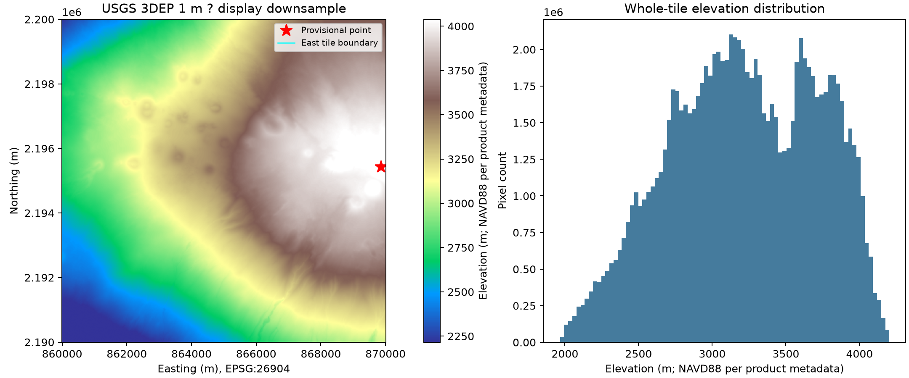

# Alternative DEM QA summary

## Mauna Kea — USGS 3DEP 1 m

Downloaded source: `data/raw/earth/mauna_kea/usgs_3dep/1m/USGS_1M_4_x86y220_HI_Hawaii_Island_Lidar_NOAA_2017_B17.tif` (270,812,447 bytes; SHA-256 `27d730f77f276bad0755ee2b9ab153a5461539b8dd0142bc619b13fc9f8f8b8c`). Catalog item `646eeb74d34e4e58932cf87e`; published 2023-05-19; lidar project source dated 2017. The catalog identifies a bare-earth topographic DEM from high-resolution lidar. Product metadata reports meters and NAVD88; raster itself does not encode a band unit or vertical CRS.

Structural report: [JSON](../../../data/metadata/earth_dem_qa/alternatives/mauna_kea_usgs_1m.json), [Markdown](../../../data/metadata/earth_dem_qa/alternatives/mauna_kea_usgs_1m.md). Raster is 10012×10012 Float32, one band, EPSG:26904, 1 m grid, PixelIsArea, nodata -999999. All 100,240,144 cells are mask-valid; min 1966.45 m, max 4202.66 m, mean 3216.75 m, population standard deviation 494.58 m. This is structural QA only, not a validation of vertical accuracy or terrain suitability.

The provisional point is inside the tile but approximately 149.5 m from its east boundary. A neighboring USGS tile may be needed once the candidate extent is agreed. No companion quality raster was supplied with this item. Do not compare raw elevations directly with Copernicus: USGS NAVD88 and Copernicus EGM2008 differ, and no datum transformation was applied.

Preview is a display-only downsample of the original and a whole-tile descriptive distribution. It is not an analysis raster, candidate boundary, or fingerprint. No ArcticDEM, REMA, Iceland, Chile, or SRTM alternative was downloaded; their evidence is catalog/documentation level as detailed in `source_comparison.md`.
