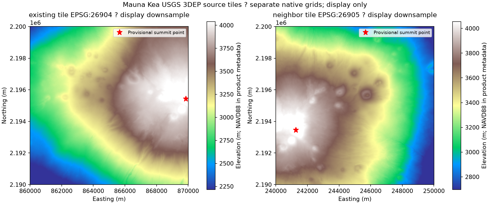

# Alternative DEM QA and remote access — Phase 2

## Mauna Kea — USGS 3DEP 1m bare-earth DEM tiles

### Existing tile x86y220

`data/raw/earth/mauna_kea/usgs_3dep/1m/USGS_1M_4_x86y220_HI_Hawaii_Island_Lidar_NOAA_2017_B17.tif` — 270,812,447 B; SHA-256 `27d730f77f276bad0755ee2b9ab153a5461539b8dd0142bc619b13fc9f8f8b8c`. EPSG:26904, 10012×10012, Float32, 1m native grid, nodata -999999. The provisional point is ~149.7m from the east edge. See [`mauna_kea_usgs_1m.json`](../../../data/metadata/earth_dem_qa/alternatives/mauna_kea_usgs_1m.json).

### Newly acquired east neighbor x24y220

Official TNM item: `USGS_1M_5_x24y220_HI_Hawaii_Island_Lidar_NOAA_2017_B17`, sourceId `646eebf0d34e4e58932cf963`. It was selected because the point is immediately inside the existing tile's east edge, and the official neighboring source tile is a manageable 224,245,197 bytes.

Local path: `data/raw/earth/mauna_kea/usgs_3dep/1m/USGS_1M_5_x24y220_HI_Hawaii_Island_Lidar_NOAA_2017_B17.tif` (224,245,197 B; SHA-256 `7d5b7020995ee5557bde2129d3a8b3ec25ebe3249ea41ed7e2ee6a9969f6d7f1`). The raw GeoTIFF was not edited and remains gitignored. Structural QA reports 10012×10012 Float32, EPSG:26905, 1m native grid, nodata -999999, min 1713.9243m, max 4207.4800m, mean 3406.9049m, standard deviation 367.9273m. See [`neighbor QA JSON`](../../../data/metadata/earth_dem_qa/alternatives/mauna_kea_usgs_1m_east.json) and [Markdown](../../../data/metadata/earth_dem_qa/alternatives/mauna_kea_usgs_1m_east.md).

The provisional point is inside both tiles. The existing tile's nearest point edge is 149.7m; the neighbor's is 1,277m. Their transformed geographic footprint bounding areas overlap by approximately 13.35 km². This supports coverage continuity around the point. The native projections differ (EPSG:26904 and EPSG:26905), so they are not the same grid and are not a ready mosaic. Do not infer accuracy from the QA mask or compare pixels without a specified preparation and datum method. No quality companion rasters were supplied.

The panels use separate native coordinate systems and are display-only downsampled previews. They are not mosaicked, resampled analysis rasters, or an AOI.

## Haughton — ArcticDEM v4.1 remote windows

STAC item `29_29_2_2_2m_v4.1` advertises COG DEM, MAD, count, min-date, max-date, and data-mask assets. HEAD reports `Accept-Ranges: bytes`; a bounded 16,384-byte range returned HTTP 206 for each. Rasterio/GDAL `/vsicurl/` successfully read the same 500×500 window near the provisional Haughton coordinate from all six assets. The DEM is EPSG:3413, Float32, nodata -9999, 512×512 blocks, with overview levels 2, 4, 8, 16, 32, 64. A display-only preview is in [figures](figures/haughton_arcticdem_remote_preview.png). The ~1.05GB DEM and companions were not saved locally; only range requests and required remote blocks were queried.

## McMurdo — REMA v2 remote windows

For `18_35_1_1_2m_v2.0`, 500×500 windows at the Wright Valley gazetteer reference read from DEM, MAD, count, min-date and max-date. The same assets were queried from `17_35_2_1_2m_v2.0` at the Victoria Valley reference. Both items report EPSG:3031, 2m posting, 512×512 blocks and overview levels 2–64; the remote windows returned data. Neither item lists a data-mask asset. Preview images are in [figures](figures/). The item A reference is not a selected study area, and the item B STAC bbox must not be used in place of its polygon geometry. No REMA raster was downloaded.

## Askja — ÍslandsDEM v1.0 remote window

The official FTP listing provides `IslandsDEMv1.0_10x10m_isn2016_zmasl.tif` (2,712,559,351 B) and other national resolution products. HTTP range access and a 500×500 window near Askja succeeded. Raster is 52000×37000, EPSG:8088, nodata approximately -3.4028235e38, tiled 512×512, no overviews. The national TIFF was not downloaded; preview is [display-only](figures/askja_islandsdem_remote_preview.png). The separate `IslandsDEMv1_lidar_dates_yyyymmdd_10x10m_isn2016.tif` companion is also range-readable, but its sampled Askja window had zero valid values. The exact 2m source-tile identifier remains unresolved; do not treat 10m national preview as an independently checked 2m tile.

The lidar-date companion header reports 52001×37001 cells, a 10m grid, nodata -9999, and a custom WKT named `Islands_Net_1993`; its filename says `isn2016`. This CRS-name mismatch needs provider clarification, and the no-data Askja sample gives no local acquisition date.

## Reproducible remote inspection

[`src/data/remote_cog_inspection.py`](../../../src/data/remote_cog_inspection.py) provides STAC asset lookup, a bounded HTTP range preflight, raster metadata checks, window reads, and a pixel-count cap. If a server ignores Range and returns HTTP 200, it closes the response before reading the body and does not invoke GDAL. Mocked tests cover supported/unsupported range, absent assets, timeouts, malformed content lengths, and valid/invalid raster metadata. Detailed remote measurements are in [`targeted_cog_access_2026-11-15.json`](../../../data/metadata/earth_dem_qa/remote/targeted_cog_access_2026-11-15.json).

## Sources not downloaded

- No full ArcticDEM or REMA mosaic asset was downloaded; each is about 1.0–1.14GB and remote windows met the display-screening need.
- No full Iceland raster was downloaded; the range-readable national file is about 2.71GB, and the exact 2m tile/AOI is unresolved.
- No SRTM was downloaded. CMR verifies `S25W070.SRTMGL1.hgt` covers the provisional Yungay point, but the local Copernicus tile already covers it and the field point remains unconfirmed. The NASA granule data link is protected.
- The neighboring USGS x24y220 tile is the only new raw raster acquired in Phase 2; it is ignored by Git.
