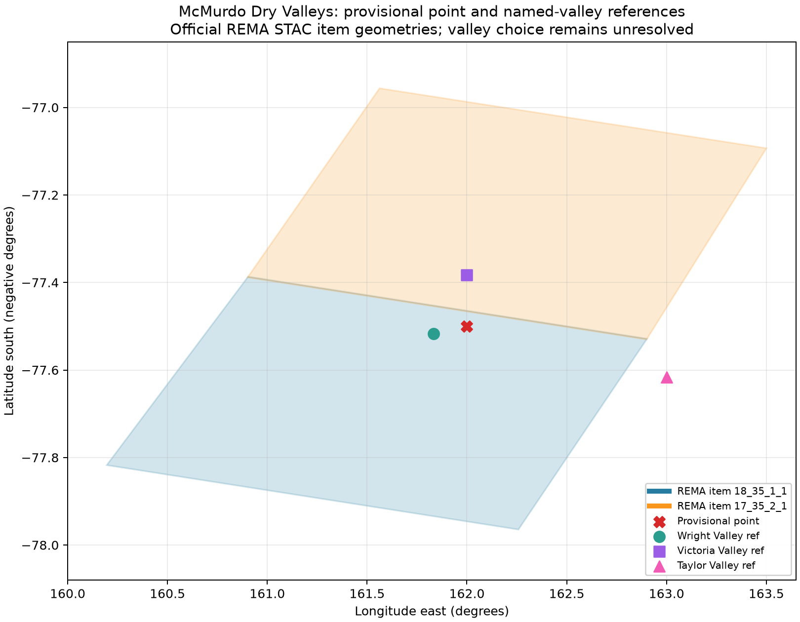

# Provisional source coverage assessment — Phase 2

**Checked:** 2026-11-15. Provisional coordinates and candidate features are not approved AOIs.

The McMurdo map draws the actual STAC item geometries, not their broad bounding boxes. Point-in-footprint checks use the GeoJSON geometry and raster bounds. The REMA COG for item `17_35_2_1_2m_v2.0` is north of the Wright Valley marker; its broad STAC bbox alone would misleadingly include some points it does not cover.

| Site / reference | Local and official-item coverage | Continuity/limitation | Current evidence level |
|---|---|---|---|
| Haughton manifest landmark; official crater reference ~1.47 km away | Copernicus tile and ArcticDEM `29_29_2_2_2m_v4.1` cover both reference positions. | Copernicus nearest edge ~8.95 km west; full crater-sector coverage must be checked against a chosen feature. ArcticDEM can be read by HTTP ranges; no full item download. | Copernicus LOCAL_QA; ArcticDEM REMOTE_WINDOW_QA. |
| McMurdo provisional regional point | Copernicus point is ~10.1 m from west edge. REMA item `18_35_1_1_2m_v2.0` geometry covers point and Wright center. Item `17_35_2_1_2m_v2.0` geometry excludes both but covers Victoria Valley center. | Gazetteer references: Wright (-77.51667, 161.83333), Victoria (-77.38333, 162.0), Taylor (-77.61667, 163.0). Approximate distances from provisional point are 4.4, 13.0, 27.4 km. Neither listed REMA item covers the Taylor reference point. Full valley extents may require additional items. | Copernicus LOCAL_QA; both REMA items REMOTE_WINDOW_QA at valley reference windows. |
| Askja volcano reference | Copernicus tile covers point. Official ÍslandsDEM 10m national raster covers it and supports remote byte-range window reads. | Copernicus south margin ~3.66 km. Official FTP offers a 10m country mosaic and 20/50m products. Exact 2m component-tile identifier was not found. The 10m file has 512x512 blocks but no overviews; it is a range-readable tiled GeoTIFF, not asserted to be a COG. | Copernicus LOCAL_QA; ÍslandsDEM 10m REMOTE_WINDOW_QA; exact 2m tile UNRESOLVED. |
| Mauna Kea summit reference | Copernicus and two USGS 3DEP 1m tiles cover point. Tile x86y220 is EPSG:26904; x24y220 is EPSG:26905. | Existing x86 point margin is ~149.7 m east. New x24y220 tile covers the point, has ~1.28 km west margin, and overlaps the transformed footprint bbox of x86y220 by ~13.35 km². These are different native grids/CRSs; coverage continuity does not make them a prepared mosaic. | USGS neighbor LOCAL_QA; catalog exact IDs/metadata verified. |
| Yungay manifest point | Copernicus tile and NASA SRTMGL1 v003 granule S25W070 cover provisional point. | Copernicus nearest edge ~7.13 km north. The Atacama ALOS regional product extent excludes the point by ~0.895° latitude. CIREN contour service requires separate access and is not a DEM raster. | Copernicus LOCAL_QA; SRTM CATALOG_VERIFIED, Earthdata asset protected/not downloaded; ALOS extent CATALOG_VERIFIED. |

The new Mauna Kea tile was downloaded because the existing 1m tile ends about 150m east of the provisional coordinate and the official adjacent item is a modest 224MB. No REMA, ArcticDEM, ÍslandsDEM, or SRTM source raster was saved. Small remote display windows were read from PGC and Iceland providers only after HTTP range support was verified. Details and byte sizes are in [`targeted_cog_access_2026-11-15.json`](../../../data/metadata/earth_dem_qa/remote/targeted_cog_access_2026-11-15.json).

## Coverage decisions still needed

1. Identify the exact McMurdo valley and sector. Item references and catalog names do not authorize a valley selection.
2. Define the landform sectors and extent for Haughton, Askja, Mauna Kea, and Yungay before deciding whether neighboring tiles are sufficient.
3. Confirm the Yungay field point from the project team; a published Yungay site is not automatically the AREA 67 field site.
4. Ask Hiba/team which CRS and vertical reference will be accepted before processing multi-zone Mauna data or mixing providers.

No polygons, dimensions, final sites, common scale, fingerprints, or similarity scores were created.
