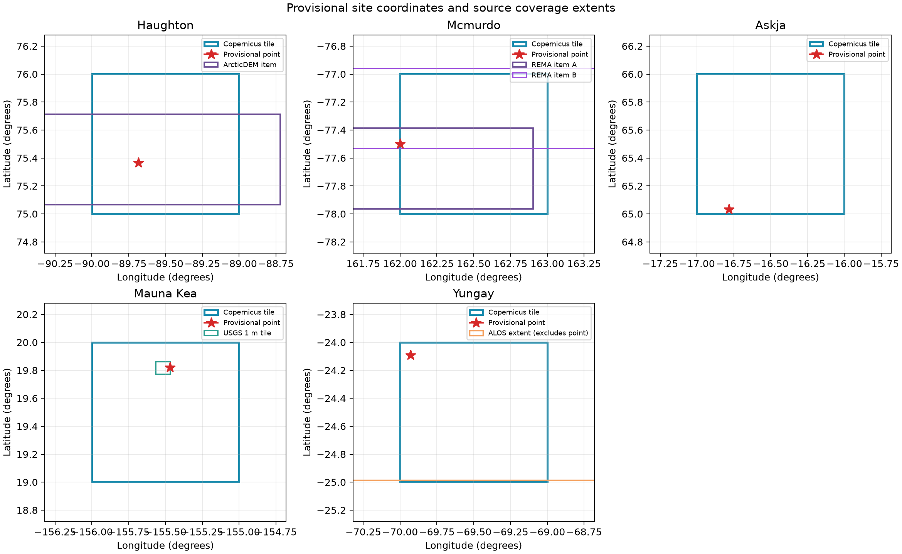

# Provisional source coverage assessment

This is a coverage screening, not a set of study-area boundaries. Point locations come from the current provisional manifest. The map shows local Copernicus footprints and verified catalog extents where available. For Askja, country-level ÍslandsDEM documentation supports national coverage but an exact item footprint could not be verified.

| Site | Point coverage | Neighbor/extent concern | Next coverage action |
|---|---|---|---|
| Haughton | Copernicus and ArcticDEM STAC item cover point | Copernicus margin ~8.95 km west; extent for a whole crater sector must be checked | Agree a crater sector; use ArcticDEM STAC item and required adjacent item(s) to establish full extent before access |
| McMurdo | Copernicus point and two REMA STAC items cover approximate point | Copernicus margin ~10 m west; point does not identify any intended valley | Identify named valley and coordinates, then inspect REMA and adjacent mosaic items there |
| Askja | Copernicus point covered; ÍslandsDEM documents national coverage | Copernicus margin ~3.66 km south; exact ÍslandsDEM tile/item unresolved | Obtain exact tile metadata/footprint and assess caldera coverage |
| Mauna Kea | Copernicus, USGS 1 m local tile and USGS 1/3 arc-sec catalog item cover point | USGS 1 m point is ~150 m from east edge | Define landform and query adjacent x24y220 tile; acquire only if approved area requires continuity |
| Yungay | Copernicus and SRTM granule cover provisional point | ALOS Atacama extent excludes point; exact field location unresolved | Confirm field coordinates, then re-query Chilean products and global alternatives |

No footprint is an approved AOI. Adjacent-tile needs depend on the eventual boundary; no candidate polygon or area size was invented. Footprint map is geographic context; polar projected source footprints were represented by catalog geographic bboxes, so edges are not authoritative survey boundaries.
